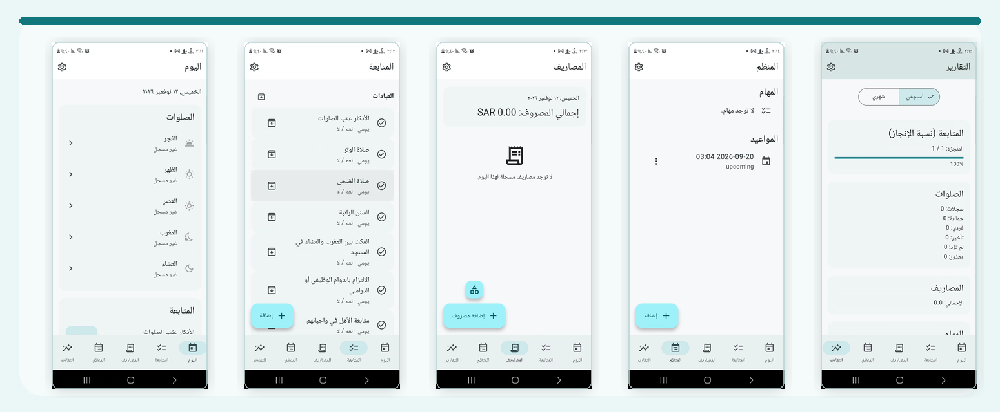

# متابعتي | Mutabaati

**تطبيق عربي لإدارة المتابعة اليومية والمصاريف والمهام والمواعيد**

**تطوير:** وهيب الكبودي | Wahib Al-Kaboudi  
**المنصة:** Android / Flutter  
**التقنيات:** Flutter · Dart · Riverpod · Drift/SQLite · GoRouter

## نبذة عن المشروع

متابعتي تطبيق عربي لإدارة جوانب مختلفة من الحياة اليومية، يجمع العادات والصلوات والمصاريف والمهام والمواعيد في مساحة واحدة مع تخزين محلي.

## الوظائف والمكونات الأساسية

- متابعة العادات والصلوات وتخصيص بنود المتابعة.
- تسجيل المصاريف وتصنيفها.
- تنظيم المهام والمواعيد والتذكيرات.
- تقارير دورية لعرض تقدم المستخدم.
- إعدادات وحقول مخصصة وواجهات نسخ احتياطي.

## صور ومخططات المشروع



### بقية الواجهات

- [01 today](screenshots/01-today.png)
- [02 today activities](screenshots/02-today-activities.png)
- [03 prayer status](screenshots/03-prayer-status.png)
- [04 settings](screenshots/04-settings.png)
- [05 tracking](screenshots/05-tracking.png)
- [06 tracking add](screenshots/06-tracking-add.png)
- [07 expenses](screenshots/07-expenses.png)
- [08 add expense](screenshots/08-add-expense.png)
- [09 organizer](screenshots/09-organizer.png)
- [10 reports](screenshots/10-reports.png)

## التقنيات المستخدمة

Flutter · Dart · Riverpod · Drift/SQLite · GoRouter

## التشغيل محليًا

```bash
flutter pub get
flutter run
```

## حالة المشروع وحدوده

بعض إعدادات تذكيرات الخلفية والنسخ الاحتياطي تحتاج تحققًا ميدانيًا على أجهزة مختلفة، ولا يُدّعى أنها مختبرة بالكامل.

## المطور وحقوق النشر

**وهيب الكبودي | Wahib Al-Kaboudi**  
Copyright © 2026 Wahib Al-Kaboudi. All rights reserved.

ما لم يُذكر ترخيص صريح آخر للملفات أو التبعيات، فإن نشر المصدر هنا لا يمنح تلقائيًا إذنًا بإعادة توزيعه أو استخدامه تجاريًا. تُحترم تراخيص المكتبات والبيانات والمكونات الخارجية كلٌّ بحسب شروطه.
